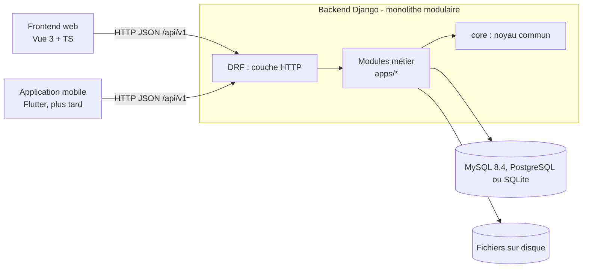
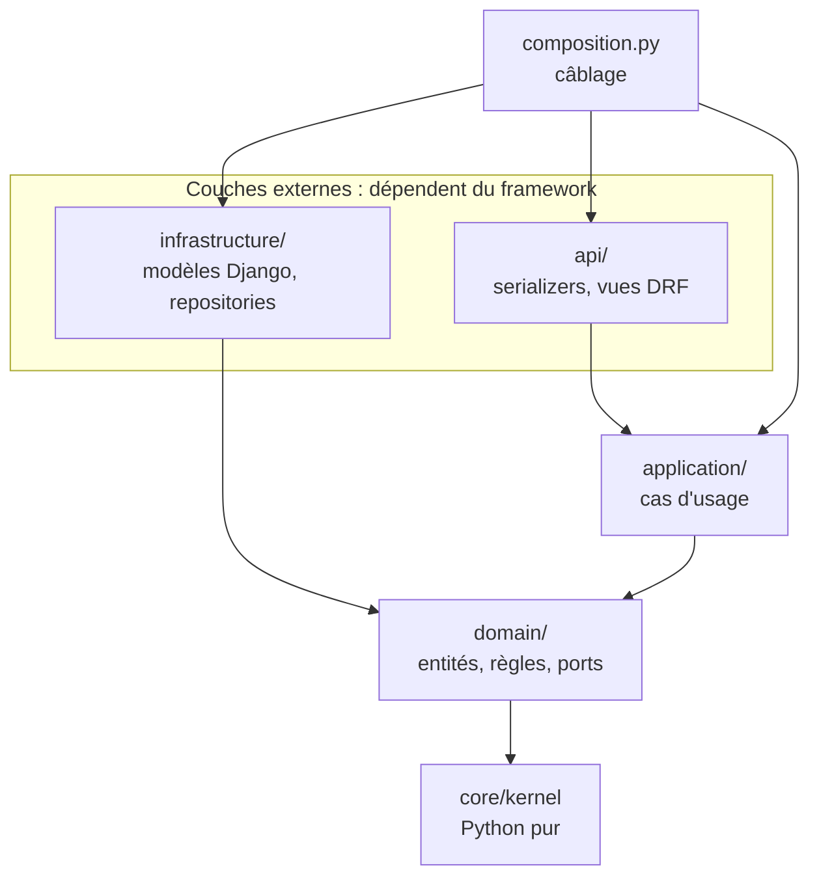
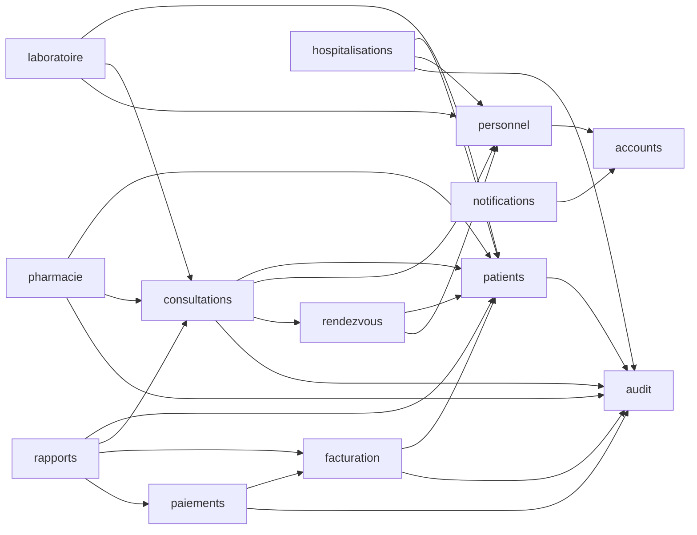

# Architecture

## 1. Vue d'ensemble



Un seul déploiement backend, des **frontières internes strictes**, **aucun service réseau
externe** (voir `06-fonctionnement-hors-ligne.md`). Si un module doit un jour être extrait en
service, ses frontières (`public.py`, événements, ports) sont déjà tracées.

## 2. Clean Architecture dans chaque module

La règle unique : **une couche ne connaît que les couches plus intérieures**.



| Couche | Contient | Ne doit PAS contenir |
|---|---|---|
| `domain/` | entité `Patient` et ses règles, erreurs, événements, **ports** (`PatientRepository`…) | Django, DRF, SQL, HTTP |
| `application/` | cas d'usage `RegisterPatient`…, dépendent des ports | Django, DRF, SQL, HTTP |
| `infrastructure/` | tables Django, repositories, adaptateurs | règles métier |
| `api/` | serializers (forme des données), vues (droits + appel d'un cas d'usage) | règles métier, accès direct à l'ORM |
| `composition.py` | choix des implémentations concrètes | logique |

**Pourquoi des ports ?** Le cas d'usage dit « j'ai besoin d'un dépôt de patients » (interface).
L'infrastructure fournit l'implémentation Django ORM ; le moteur relationnel se choisit par
`DATABASE_URL` (SQLite, MySQL ou PostgreSQL) et les tests métier fournissent une liste en mémoire.
Le métier ne sait jamais où sont stockées les données.

Flux d'une création : `POST /api/v1/patients/` → `HasActionPermission` (`patients.add_patient`)
→ `PatientWriteSerializer` (forme) → `RegisterPatient.execute` (transaction, numéro de dossier,
entité `Patient.register` qui valide les règles, doublon, repository, audit, événement après
commit) → `PatientDetailSerializer` (réponse).

### Vérification automatique

`backend/tests/architecture/` analyse les imports de chaque fichier :

- `domain/` : bibliothèque standard + lui-même + `core.kernel` uniquement ;
- `application/` : en plus, rien d'autre que `domain` ;
- `api/` : jamais `infrastructure` ni l'ORM (il passe par `composition`) ;
- `infrastructure/` : jamais `api` ;
- `core/kernel/` : Python pur ; `core` ne dépend d'aucun module métier ;
- aucun broker ni SDK cloud dans `requirements/base.txt`.

## 3. Dépendances entre modules

Source de vérité : `backend/apps/dependencies.py`.



**Règles (testées)** :
1. Un module n'importe un autre que via `apps.<autre>.public`.
2. La dépendance doit être déclarée dans `dependencies.py` ; le graphe reste sans cycle.
3. Les références entre modules se font par **identifiant public (UUID)**, sans clé étrangère
   ni import de modèle (ex. `Patient.created_by_public_id`).
4. Une opération qui traverse plusieurs modules est orchestrée par le module « appelant », souvent
   en réaction à un événement : jamais par un module « dieu ».
5. `domain/` et `application/` n'importent jamais un autre module ; seuls `composition.py` et
   `infrastructure/` le font, via son `public.py`.

## 4. Application des principes SOLID

| Principe | Mise en œuvre concrète |
|---|---|
| **S** - responsabilité unique | Entité = règles ; cas d'usage = scénario ; repository = stockage ; vue = HTTP ; serializer = forme des données |
| **O** - ouvert/fermé | Nouveau module = nouveau dossier + une ligne dans `api_v1.py` ; autre stockage = nouvelle classe de repository ; rôles ajoutés dans `domain/roles.py` |
| **L** - substitution | `PatientRepository` est interchangeable entre SQLite, MySQL, PostgreSQL et le dépôt mémoire de test |
| **I** - ségrégation des interfaces | Ports minces (`AuditTrail` : 1 méthode ; `Clock` : 2) ; `public.py` n'expose que le nécessaire |
| **D** - inversion des dépendances | Les cas d'usage reçoivent leurs ports par le constructeur ; `composition.py` fournit les implémentations |

## 5. Frontend

```text
src/
├── app/        routeur (auto-découverte des modules), layouts, navigation
├── core/       client HTTP, erreurs, auth (jetons, store, gardes), i18n, config, types OpenAPI
├── shared/     composants UI et composables réutilisables, sans logique métier
└── modules/    un dossier par module métier (api, components, composables, pages, routes)
```

- Un seul client HTTP (`core/api/http.ts`) : jeton, rafraîchissement unique en cas de 401.
- Les types viennent du contrat OpenAPI : un champ renommé côté backend casse la compilation.
- Les droits affichés ne sont qu'ergonomiques ; le serveur décide.
- **Clean Architecture côté frontend** : traitée dans l'étape frontend (après le backend). Cible :
  `modules/<nom>/{domain, application, infrastructure, ui}` avec la même règle de dépendance.

## 6. Scalabilité et évolutivité

| Besoin | Levier prévu |
|---|---|
| Charge en lecture | Réplicas MySQL, index, pagination, cache (fichiers ou mémoire) |
| Traitements lourds (PDF, exports) | Tâches planifiées/en base derrière le port `EventPublisher` (sans broker externe) |
| Fichiers volumineux | Disque ou NAS local ; stockage objet seulement si une connexion existe |
| Plusieurs processus | API **sans état** (JWT), plusieurs workers gunicorn, `/health/ready/` |
| Nouvelle fonctionnalité | Nouveau module ou nouveau cas d'usage, sans modifier les autres |
| Changer de moteur relationnel | Changer `DATABASE_URL` entre SQLite, MySQL et PostgreSQL ; appliquer les migrations et migrer les données séparément |
| Changer de famille de base | Écrire un adaptateur dédié ; MongoDB n'est pas pris en charge actuellement |

## 7. Maintenabilité

- Conventions **exécutables** : `ruff`, tests d'architecture, couverture minimale en CI.
- Tests du métier **sans base de données** (rapides) ; quelques tests d'intégration avec base.
- Documentation à côté du code (`MODULE.md` par module) et décisions tracées (ADR).
- Contrat d'API versionné : tout changement est visible en revue de code.

## 8. Ajouter un module (procédure)

1. Copier la structure d'un module de référence (`apps/patients/`), renommer, adapter `apps.py`.
2. Déclarer le module dans `config/settings/base.py` (`LOCAL_APPS`), `apps/dependencies.py` et `config/api_v1.py`.
3. Écrire dans cet ordre : `domain/` → `application/` → `infrastructure/` → `composition.py` → `api/` → `public.py`, avec les tests.
4. Ajouter ses permissions dans `apps/accounts/domain/roles.py`, puis `make seed`.
5. `makemigrations`, puis `make schema` pour mettre à jour le contrat ; créer `frontend/src/modules/<nom>/` si besoin.
6. `make check`.
